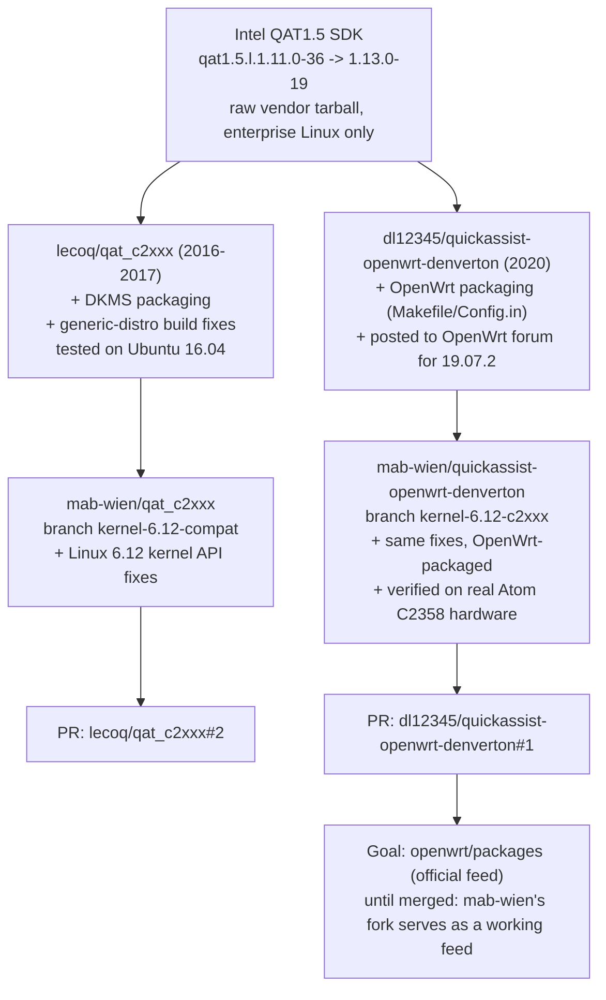

# QAT1.5 C2xxx patches for Linux 6.12 (OpenWrt)

Kernel-API compatibility patches to build Intel's QuickAssist Technology 1.5
driver (`qat1.5.l.1.13.0-19`, vendor package for Atom C2000/C2xxx SoCs such as
the C2358) against a modern Linux kernel (6.12) inside an OpenWrt SDK build
(`package/utils/quickassist-c2xxx`).

The goal was **not** to redesign the driver, but to touch it as little as
possible: patches only rebuild an API when the underlying kernel API was
genuinely removed or changed semantics (PCIe AER, `dma_set_mask`,
`vm_flags_set`, `/proc` `proc_ops`, `-Werror=missing-prototypes`, etc.).
Everything else is left as close to the vendor source as possible.

## Status

- Full kernel driver stack (OSAL, ADF, LAC/lookaside crypto) builds cleanly
  for kernel 6.12.94 (`icp_qa_al.ko`, `usdm_drv.ko`).
- User-space stack (`libicp_qa_al_s.so`, `libusdm_drv_s.so`, `adf_ctl`) builds
  and the SDK's own `cpa_sample_code` performance tool runs against **real
  Intel QAT hardware** (Atom C2358 / Coleto Creek, `8086:1f18`).
- Verified: symmetric ciphers (AES-CBC 128/256, KASUMI), algorithm chaining
  (cipher+HMAC), RSA/DH/DSA/ECDSA — all pass with zero errors, throughput up
  to ~6.7 Gbit/s on AES128-CBC. See the issue tracker for the full test report.
- **Not yet done:** strongSwan/XFRM/LKCF integration (i.e. actual IPsec
  offload). This has only been validated with the SDK's own standalone test
  tool so far.

## What's here

This repo contains **only the patches**, not the vendor SDK source (Intel's
QAT1.5 package has its own license terms). Patches are numbered in
application order; see each patch's filename for what it does. They are
meant to be dropped into the `patches/` directory of the OpenWrt
`quickassist-c2xxx` package, which applies them against the pristine
`qat1.5.l.1.13.0-19.tar.gz` vendor source during its normal `Build/Patch`
step (`quilt`/OpenWrt patch application, `-p1`).

## Lineage

Not a straight line — Intel's reference driver was picked up independently
by two separate community efforts before this work touched either of them:

## Goal

Short-term, this repo plus the two PRs above are the deliverable: a working,
hardware-verified kernel-6.12 port. Longer-term, the aim is to get the
underlying fixes merged upstream (into `lecoq/qat_c2xxx` and
`dl12345/quickassist-openwrt-denverton` respectively) and then propose
`quickassist-c2xxx` for inclusion in the official
[openwrt/packages](https://github.com/openwrt/packages) feed, once it's
kept current and strongSwan/XFRM integration has been proven out. Until any
of that happens, `mab-wien/quickassist-openwrt-denverton` (branch
`kernel-6.12-c2xxx`) can be used directly as a third-party feed
(`feeds.conf.default`) for anyone who needs it now.

## Related repos

This work spans three repos (this patch-set archive, plus a branch each on
forks of the vendor driver and the OpenWrt package feed). Run
`./checkout.sh` to clone all three, each already on the right branch.

## Links

- Full test report: [issue #1](https://github.com/mab-wien/qat-c2xxx-patches/issues/1)
- OpenWrt package PR (against the `quickassist-openwrt-denverton` feed):
  https://github.com/dl12345/quickassist-openwrt-denverton/pull/1
- Vendor driver PR (against @lecoq's maintained fork):
  https://github.com/lecoq/qat_c2xxx/pull/2
- OpenWrt forum discussion:
  https://forum.openwrt.org/t/intel-quick-assist-v1-5-drivers-and-openssl-1-1-1e-acceleration-engine-for-19-07-2/58692
